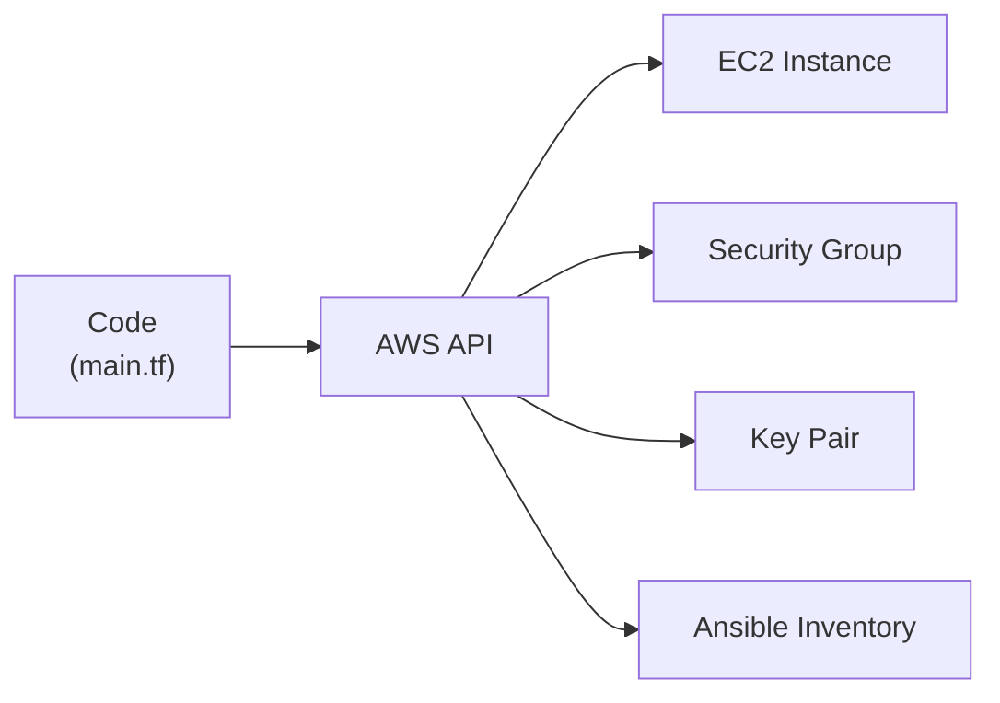
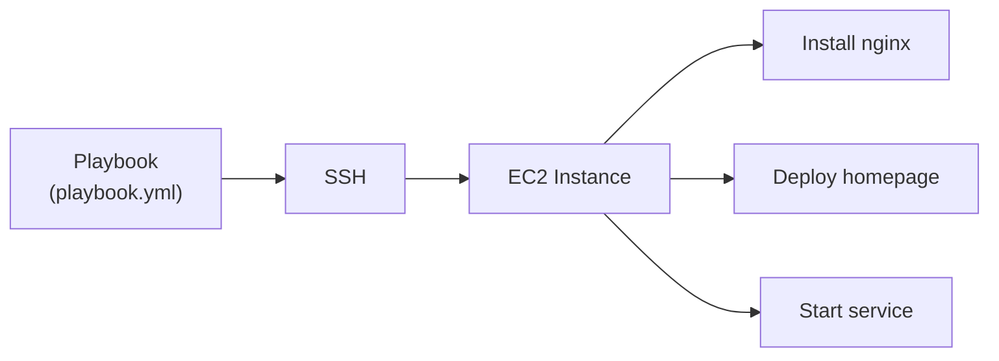

# 🚀 nginx on EC2 — Terraform + Ansible

Learn Infrastructure as Code and Configuration Management in 55 minutes!

```
ec2-nginx-ansible/
├── terraform/           # Infrastructure as Code - creates EC2 instance
│   ├── main.tf         # EC2, security group, key pair resources
│   ├── variables.tf    # Input variables (region, instance type, etc.)
│   ├── outputs.tf      # What to show after deployment
│   └── backend.tf      # State storage configuration
├── ansible/            # Configuration as Code - sets up nginx
│   └── playbook.yml    # Install, configure, and test nginx
├── Makefile            # Automation commands (run with: make help)
└── DEMO.md             # 📖 Step-by-step classroom demo guide
```

## 🎓 For Classroom Use

**→ See [DEMO.md](DEMO.md) for a complete step-by-step demo guide**

That file has everything you need to run this in a classroom:
- Detailed talking points
- Timing for each step  
- Troubleshooting tips
- Discussion questions
- Learning extensions

## ⚡ Quick Start (5 minutes)

**Prerequisites:**
- Terraform >= 1.5
- Ansible >= 2.14  
- AWS credentials configured (`aws configure`)
- SSH key pair (`ssh-keygen -t ed25519`)

**Deploy everything in one command:**
```bash
make demo-setup
```

That's it! This runs:
1. Terraform to create the EC2 instance
2. Ansible to install and configure nginx
3. Shows you the URL to access it

**Visit your website:**
```bash
curl $(terraform -chdir=terraform output -raw url)
# Or open the URL in your browser
```

**Destroy everything (saves AWS costs):**
```bash
make demo-destroy
# Type 'destroy-demo' to confirm
```

## 🏗️ Step-by-Step Manual Walkthrough

### 1. Validate Code (no AWS resources created yet)

```bash
# Check Terraform syntax
make tf-validate

# Check Ansible playbook syntax
make ansible-check

# Or both at once
make local-test
```

### 2. Create the EC2 Instance

```bash
# See what will be created
make tf-plan SSH_CIDR=$(curl -s https://checkip.amazonaws.com)/32

# Create it (you'll be asked to confirm)
make tf-apply SSH_CIDR=$(curl -s https://checkip.amazonaws.com)/32
```

This creates:
- ✅ EC2 instance (t3.micro - free tier eligible)
- ✅ Security group (firewall with SSH + HTTP)
- ✅ Key pair (for SSH authentication)
- ✅ Ansible inventory file (tells Ansible how to reach the instance)

### 3. Configure the Instance

```bash
# Install nginx and deploy a test page
make ansible-run
```

This:
- Waits for the instance to finish booting
- Installs nginx package
- Deploys a custom homepage
- Starts the nginx service
- Tests that it's working

### 4. Access Your Website

```bash
# Get all deployment details
make demo-info

# Or just the URL
terraform -chdir=terraform output url

# Access it
curl $(terraform -chdir=terraform output -raw url)
```

### 5. Explore (Optional)

```bash
# SSH into the instance
ssh -i ~/.ssh/id_ed25519 ubuntu@$(terraform -chdir=terraform output -raw public_ip)

# Look around
ps aux | grep nginx          # See nginx processes
systemctl status nginx       # Check nginx status
cat /var/www/html/index.html # See the homepage
```

### 6. Clean Up

```bash
# Destroy everything (don't forget this!)
make demo-destroy
# Type 'destroy-demo' to confirm
```

## 📋 Makefile Commands

```bash
make help              # Show all available commands
make local-test        # Validate code (no AWS)
make demo-setup        # Full deployment (provision + configure)
make demo-status       # Show deployment details
make demo-info         # Show IP, URL, instance details
make demo-destroy      # Delete everything

# Or individual steps:
make tf-init           # Download Terraform plugins
make tf-plan           # Show what will be created
make tf-apply          # Create EC2 instance
make tf-destroy        # Delete EC2 instance
make ansible-check     # Validate playbook syntax
make ansible-run       # Configure the instance
make clean             # Remove state files
```

## 🔍 What's Happening?

### Terraform
Terraform **provisions** infrastructure (creates the servers):



**Key Resources:**
- **EC2 Instance**: The virtual machine that runs nginx
- **Security Group**: Firewall rules (SSH from your IP, HTTP from internet)
- **Key Pair**: SSH credentials (uploaded to AWS)

### Ansible
Ansible **configures** the infrastructure (installs software):



**Key Tasks:**
- **Wait for SSH**: Ensure instance is fully booted
- **Install nginx**: Use apt package manager
- **Deploy page**: Upload custom HTML
- **Start service**: Make nginx run on boot

## 🎓 Key Concepts

### Infrastructure as Code (IaC)
Instead of clicking AWS Console buttons, you write code. Benefits:
- ✅ Reproducible (same code = same result)
- ✅ Versionable (track changes in git)
- ✅ Reviewable (code reviews catch mistakes)
- ✅ Automated (deploy in minutes, not hours)
- ✅ Testable (validate before deploying)

### Configuration Management
Instead of running commands by hand, you write playbooks. Benefits:
- ✅ Idempotent (safe to run multiple times)
- ✅ Documented (code shows what's installed)
- ✅ Automated (deploy to 100 servers the same way)
- ✅ Traceable (git history of configuration changes)

### Real-World Use Cases
- **Development**: Spin up test environments automatically
- **Staging**: Identical to production, but separate  
- **Production**: Deploy with confidence
- **Disaster Recovery**: Recreate infrastructure from code
- **Cost Control**: Destroy unused resources automatically
- **Multi-Cloud**: Same playbooks work on AWS, Azure, GCP

## ⚠️ Important: AWS Costs

This uses **t3.micro** (free tier eligible for 12 months):
- ✅ Free for first 12 months (new AWS accounts)
- ⚠️ Always run `make demo-destroy` after the demo!
- 💰 Forgotten instance for 1 month ≈ $7

**Always clean up:**
```bash
make demo-destroy  # Type 'destroy-demo' to confirm
```

## 🔧 Troubleshooting

**"Terraform not found"**
```bash
brew install terraform  # macOS
sudo apt-get install terraform  # Linux/Ubuntu
```

**"Ansible not found"**
```bash
pip install ansible
# or on macOS: brew install ansible
```

**"AWS credentials not found"**
```bash
aws configure
# Enter your Access Key, Secret Key, region, and output format
```

**"SSH timeout or connection refused"**
- Wait 1-2 minutes for the instance to fully boot
- Check Security Group allows SSH from your IP
- Verify your IP with: `curl https://checkip.amazonaws.com`

**"Ansible unreachable"**
- Run `make demo-info` to see the IP address
- Try SSH manually: `ssh -i ~/.ssh/id_ed25519 ubuntu@<IP>`
- Check AWS Console → EC2 → Running instances

## 📚 Further Learning

**Terraform:**
- [Terraform AWS Provider Docs](https://registry.terraform.io/providers/hashicorp/aws/latest)
- [Terraform Best Practices](https://www.terraform.io/language)

**Ansible:**
- [Ansible Official Docs](https://docs.ansible.com/)
- [Module Reference](https://docs.ansible.com/ansible/latest/collections/ansible/builtin/)

**AWS:**
- [EC2 Documentation](https://docs.aws.amazon.com/ec2/)
- [VPC & Networking](https://docs.aws.amazon.com/vpc/)
- [Security Groups](https://docs.aws.amazon.com/vpc/latest/userguide/VPC_SecurityGroups.html)

**Try These Next:**
1. Change the instance type to `t3.small` (more CPU/memory)
2. Add HTTPS by modifying the security group to allow port 443
3. Deploy multiple instances and use a load balancer
4. Add tags to track costs
5. Use different regions (what's the latency from your country?)

## 📧 Getting Help

If something goes wrong:
1. Read the error message carefully
2. Run `make local-test` to check code syntax
3. Check the [DEMO.md](DEMO.md) troubleshooting section
4. Post the full error output in your class forum
5. Check AWS Console for resource details

---

**Ready to deploy?** Run `make demo-setup` 🚀
